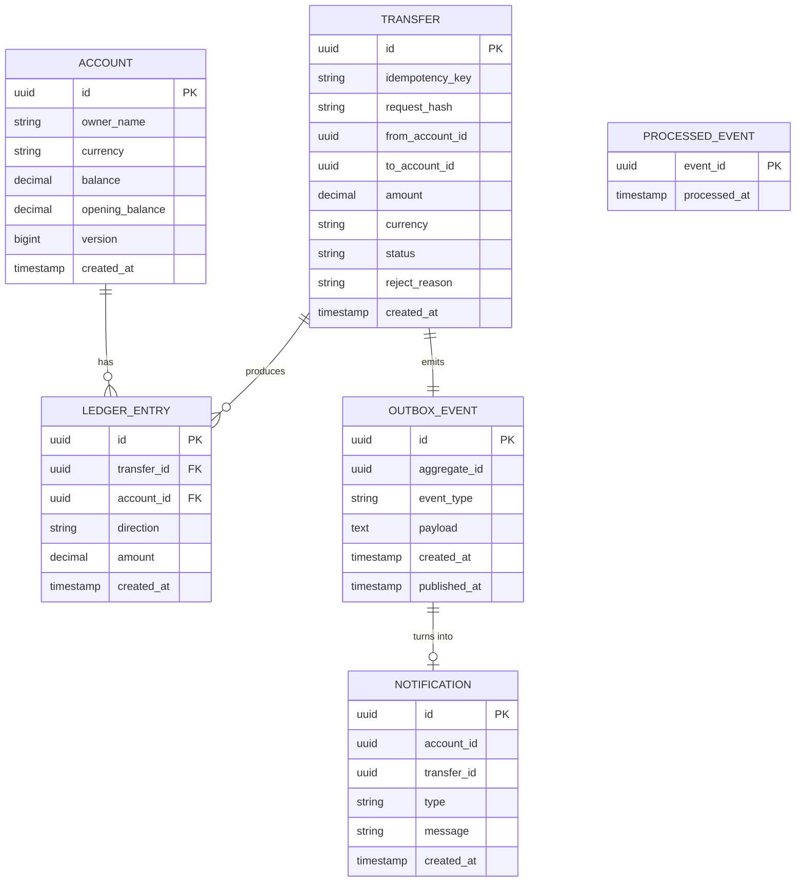
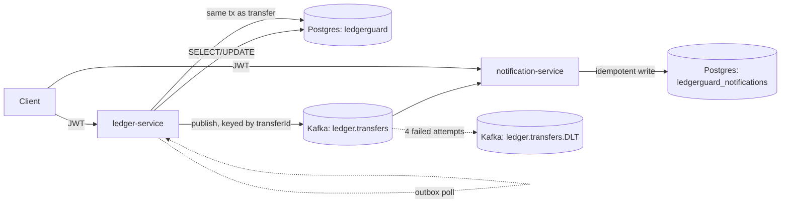
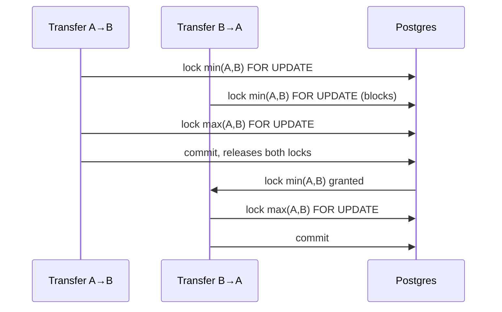

# LedgerGuard Design Spec

## 1. Requirements

LedgerGuard is an event-driven payments ledger made of two Spring Boot microservices. Its one
hard requirement, the thing every other design decision serves: **it must never double-charge,
lose, or create money, even under heavy concurrency.** Concretely:

- Every completed transfer is recorded as a balanced double-entry pair (one DEBIT, one CREDIT,
  equal amounts) -- money only ever moves between two accounts inside the system, never appears
  or disappears.
- A client retrying the same request (same `Idempotency-Key`, same body) never moves money twice.
- A client reusing a key with a *different* body is rejected outright (409), rather than silently
  doing one of the two things they might have meant.
- Concurrent transfers touching the same account(s) never corrupt a balance, regardless of which
  of the two supported locking strategies is active.
- A completed or rejected transfer is reflected downstream (as a notification) exactly once, even
  if the message that announces it is delivered more than once.
- Every invariant above is independently checkable at any time via `GET /reconciliation`.

## 2. Data model

`ACCOUNT`, `TRANSFER`, `LEDGER_ENTRY`, and `OUTBOX_EVENT` live in ledger-service's database.
`NOTIFICATION` and `PROCESSED_EVENT` live in notification-service's own, separate database --
the two services never share a schema or reach into each other's tables; they only communicate
through the `ledger.transfers` Kafka topic. `opening_balance` is immutable from the moment an
account is created and is what the reconciliation invariants are checked against.

## 3. Architecture

Both services are independently deployable Spring Boot apps. ledger-service owns accounts,
transfers, and the authoritative double-entry ledger; notification-service only ever reacts to
events it reads off Kafka plus serves `GET /notifications/{accountId}`. Neither calls the other
over HTTP.

## 4. Double-entry

Every **completed** transfer writes exactly two `LedgerEntry` rows in the same transaction as the
balance update: a `DEBIT` against the source account and a `CREDIT` against the destination
account, both for the same amount. This is enforced by construction in
`LedgerMutationService.apply()` -- there is no code path that writes one without the other, and a
**rejected** transfer (insufficient funds, same account, currency mismatch) writes *zero* ledger
entries. `GET /reconciliation` independently verifies this held: invariant (c) checks that every
transfer's entries net to zero, invariant (b) checks every account's balance equals
`openingBalance + credits - debits`, and invariant (a) checks the sum of all balances still
equals the sum of all opening balances (since transfers only move money between accounts in the
system, that sum can never change).

## 5. Idempotency

`POST /transfers` requires an `Idempotency-Key` header. `TransferService.submit()`:

1. Hashes the semantically-relevant fields of the request (`from`, `to`, `amount`, `currency`)
   with SHA-256.
2. Looks up an existing `Transfer` by that key.
   - **Found, hash matches:** this is a replay. Return the original result (HTTP 200), with no
     call into either locking strategy -- no new money movement, no new ledger entries.
   - **Found, hash differs:** the same key was reused for a different request. Reject with 409.
   - **Not found:** proceed to execute a new transfer.
3. If two concurrent requests both pass step 2 with the same brand-new key (a genuine race, not a
   sequential replay), the database's `UNIQUE` constraint on `idempotency_key` lets exactly one of
   them insert its `Transfer` row; the loser's insert throws `DataIntegrityViolationException`,
   which `TransferService` catches and resolves the same way as step 2 -- it re-reads the row the
   winner just committed and returns that result instead of failing the request.

Because the entire "validate, move funds, write entries, write the transfer row, write the outbox
row" sequence happens inside one locking strategy's transaction (see below), a transfer is either
fully applied or not applied at all -- there's no window where a crash leaves a half-written,
ambiguous result for a retry to stumble into.

## 6. Locking strategies and the deadlock rule

`ledger.locking` selects which `TransferExecutor` bean is active (`PESSIMISTIC` or `OPTIMISTIC`,
mutually exclusive via `@ConditionalOnProperty`); both delegate the actual validate-and-mutate
logic to the same `LedgerMutationService`, so the money-movement rules are identical regardless
of which is chosen.

**PESSIMISTIC** (`PessimisticTransferExecutor`) takes `SELECT ... FOR UPDATE` on both accounts
inside one transaction before doing anything else. Critically, it always locks in **ascending
account-id order**, regardless of which account is logically "from" or "to":

Without that fixed ordering, two transfers between the same pair of accounts in opposite
directions could each successfully lock their own "first" account and then block forever waiting
for the other's "second" account -- a classic deadlock. Locking in a consistent global order
(by id, independent of transfer direction) makes that impossible: whichever transfer gets there
first always acquires *both* locks before the other one acquires *either*.

**OPTIMISTIC** (`OptimisticTransferExecutor` + `OptimisticAttemptRunner`) takes no locks up
front. It loads both accounts normally, relies on each `Account`'s `@Version` column to detect a
conflicting concurrent update at commit time, and retries the whole attempt (in a fresh
`REQUIRES_NEW` transaction) with exponential backoff and jitter, up to
`ledger.optimistic-retry.max-attempts` (default 10) times. A chaos/benchmark run surfaced a
subtlety here: because optimistic locking takes no explicit locks, it has no fixed acquisition
order either, so Postgres can detect an actual **deadlock** between two transfers updating the
same pair of accounts in opposite order (`CannotAcquireLockException`), not just an `@Version`
conflict (`ObjectOptimisticLockingFailureException`). Both are retried identically by catching
their common superclass, `ConcurrencyFailureException` -- otherwise a deadlocked attempt would
propagate out and silently drop the transfer instead of retrying it. If retries are exhausted,
nothing has been persisted (no partial state), so the client gets a 503 and can safely retry with
the same `Idempotency-Key`.

The two strategies are benchmarked against each other under heavy contention in
[benchmark.md](benchmark.md): PESSIMISTIC pays a small, predictable locking cost and wins
decisively when a handful of "hot" accounts see concurrent traffic; OPTIMISTIC wins when
contention is low (most transfers don't collide) because it never pays any locking cost at all in
the common case, but degrades sharply as contention rises.

## 7. Outbox, Kafka, the idempotent consumer, and the DLT

ledger-service never calls Kafka from inside the request path. Instead, `LedgerMutationService`
writes an `OutboxEvent` row (JSON payload, `TRANSFER_COMPLETED` or `TRANSFER_REJECTED`) in the
*same transaction* as the transfer and its ledger entries -- so "the transfer happened" and "an
event exists to publish" are atomic; neither can happen without the other.

A separate `@Scheduled` `OutboxPublisher` polls for unpublished rows (every 500ms by default) and
sends each one to `ledger.transfers`, keyed by `transferId` so every event for one transfer lands
on the same partition, and stamps `publishedAt` only *after* the Kafka broker acknowledges the
send. The read uses `SELECT ... FOR UPDATE SKIP LOCKED`: if the publisher runs on more than one
instance, or a manual run overlaps with the scheduler, each caller locks a disjoint set of rows
instead of two of them picking up and republishing the same event -- this was a real bug caught by
`OutboxPublisherTest`, not a hypothetical one. The Kafka producer has `enable.idempotence=true`
and `acks=all`, so even a network blip that makes the producer retry a send never results in two
copies of the same record landing in the same partition.

None of that fully eliminates duplicate delivery, though -- a crash between "Kafka acked" and
"`publishedAt` committed" will republish on the next poll, and Kafka consumer groups redeliver
after a rebalance regardless of what the producer does. So notification-service's
`TransferEventListener` is **idempotent by construction**: before creating any notifications, it
checks the event's id (carried as a Kafka header, the outbox row's own id) against a
`ProcessedEvent` table, and writes the notifications plus a `ProcessedEvent` row marking the event
handled in one transaction. A redelivered event finds its id already present and is a no-op. This
is proven by an end-to-end test that publishes the exact same event twice and asserts exactly one
notification per recipient, not two.

Processing failures (not duplicates -- genuine errors) are retried with backoff via
`@RetryableTopic` (4 attempts, exponential backoff); once exhausted, the record is routed to
`ledger.transfers.DLT` and logged by a `@DltHandler`.

## 8. Security and failure modes

Both services are stateless JWT resource servers. ledger-service additionally issues tokens from
`POST /auth/token` against two in-memory demo users (`alice` / `admin`, BCrypt-hashed passwords);
notification-service only verifies tokens, using the same shared signing secret, since clients
always get their token from ledger-service. In this demo, an account's owner is identified by its
`ownerName` matching the JWT subject -- a USER may only read or transfer from an account they
own (`OwnershipGuard`), ADMIN bypasses that check and is the only role that can call
`GET /reconciliation`. 401 and 403 are returned as RFC 7807 `problem+json`, written directly by a
custom `AuthenticationEntryPoint`/`AccessDeniedHandler` for filter-chain-level denials (missing or
invalid token, insufficient role) and by `@RestControllerAdvice` for everything else (validation
errors, business rejections, not-found).

Failure modes and how they're handled:

| Failure | Handling |
|---|---|
| Insufficient funds / same account / currency mismatch | Transfer is persisted as `REJECTED` with a reason; zero ledger entries written; HTTP 201 (it's a successful *request* with a business outcome, not a client error) |
| Idempotency-Key reused with a different body | HTTP 409, nothing executed |
| Concurrent insert race on a brand-new Idempotency-Key | Resolved transparently to the winner's result; caller never sees an error |
| Optimistic retry exhaustion (contention or repeated deadlock) | HTTP 503; nothing persisted; safe to retry with the same key |
| Kafka send fails or times out | Outbox row stays unpublished; retried on the next poll; no data loss |
| Notification processing error | Retried with backoff, then dead-lettered to `ledger.transfers.DLT` rather than blocking the partition forever |
| Invalid/missing/expired JWT | 401 problem+json |
| Valid JWT, wrong role or doesn't own the account | 403 problem+json |
